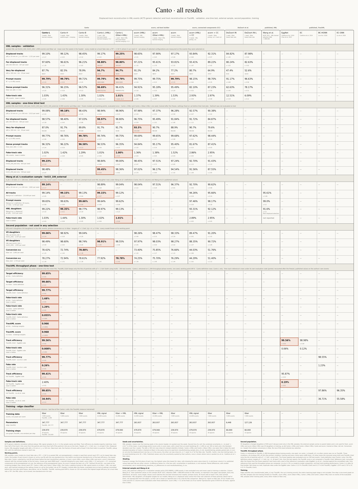

<p align="center">
  
</p>

<h1 align="center">Canto</h1>

<p align="center">
  <b>Graph-neural-network track reconstruction for displaced particles:<br>
  higher efficiency for a known signal, and strong generalization to particles it has not seen</b><br>
  <sub><b>C</b>hained-triplet, origin-<b>A</b>gnostic <b>N</b>etworks for <b>T</b>racking <b>O</b>ff-vertex</sub>
</p>

<p align="center">
  
  
  
  <a href="https://gitlab.cern.ch/gnn4itkteam/acorn/-/tree/99d153418981cba9018e70b476fc7ea0f17bacd4"></a>
  
</p>

<p align="center">
  <a href="#results">Results</a> ·
  <a href="#how-canto-works">How Canto works</a> ·
  <a href="#installation">Installation</a> ·
  <a href="#data">Data</a> ·
  <a href="#reproducing-the-results">Reproducing</a> ·
  <a href="#repository-layout">Layout</a>
</p>

---

Charged particles from the decay of a long-lived particle start far from the collision point, and trackers built
for prompt particles lose many of them. Canto has two aims:

- **Higher reconstruction efficiency for the displaced particles of a known signal.** Canto keeps the three stages of
  the Exa.TrkX pipeline (graph construction, edge classification, track building) and changes each one for particles
  produced off the vertex. Trained on the HNL signal, Canto-L finds 99.17 ± 0.32 % of the displaced HNL daughters on
  validation, against 98.65 ± 0.31 % for acorn trained on the same events (one Canto seed). Even trained without the
  signal, Canto-L finds 99.08 ± 0.15 % of them on the one-time test, 1.10 ± 0.22 points more than the signal-trained
  acorn (post-freeze).
- **Strong generalization to displaced particles it has not seen.** A search for long-lived particles whose
  properties are not known in advance cannot train its tracker on the signal it looks for. Trained on generic
  top-quark pair (ttbar) events, Canto finds as many displaced HNL daughters as when it is trained on the signal, and
  it finds K<sub>S</sub> and Λ daughters, which ttbar events do not contain, as well as the baselines that were
  trained on events containing them.

The benchmark is a public sample of heavy neutral leptons (HNLs), pp → W → μN, N → νμ⁺μ⁻, in the ACTS generic
detector without pileup. Canto is also tested on the TrackML challenge, with pileup 200 and noise hits.

## Results

### Displaced-track efficiency: HNL benchmark, test sets

The models were frozen on validation and evaluated once on the test sets (6,999 HNL events and the ttbar test set);
this evaluation decides the three [preregistered claims](docs/preregistration.md), which hold for Canto-L against
acorn (HNL) with connected components at its preregistered cut. The comparisons with the acorn builders chosen on
validation are post-freeze and descriptive. Canto is trained on ttbar only; acorn (HNL) on the HNL signal.
Efficiencies in percent; uncertainties combine the event bootstrap and the spread of three training seeds; bold: the
best value of each row among the columns shown.

| | Canto-L | Canto-H | Canto-B | acorn (ttbar),<br>builder chosen<br>on validation | acorn (HNL),<br>builder chosen<br>on validation | acorn (HNL),<br>CC at the<br>preregistered cut |
|:---|:---:|:---:|:---:|:---:|:---:|:---:|
| Displaced HNL daughters (\|d₀\| ≥ 10 mm or r<sub>v</sub> ≥ 100 mm) | 99.08 ± 0.15 | **99.18 ± 0.13** | 98.43 ± 0.26 | 96.28 ± 0.56 | 97.98 ± 0.20 | 92.57 ± 0.47 |
| \|d₀\| 100–300 mm | **98.57 ± 0.39** | 98.40 ± 0.43 | 97.03 ± 0.88 | 91.84 ± 1.80 | 96.75 ± 0.59 | 91.72 ± 1.12 |
| \|d₀\| ≥ 300 mm (found / total, three seeds pooled) | 94 / 108 | 99 / 108 | 97 / 108 | 96 / 108 | **101 / 108** | 98 / 108 |
| Prompt muons (W → μ) | 99.77 ± 0.06 | 99.76 ± 0.06 | **99.78 ± 0.06** | 99.68 ± 0.08 | 99.69 ± 0.07 | 97.62 ± 0.32 |
| Prompt tracks in ttbar (\|d₀\| < 1 mm) | 96.32 ± 0.24 | 96.22 ± 0.16 | **96.58 ± 0.13** | 95.40 ± 0.22 | 94.84 ± 0.20 | 81.67 ± 0.33 |
| Fake-track rate (lower is better) | **1.02 ± 0.03** | 1.42 ± 0.04 | 1.29 ± 0.05 | 1.52 ± 0.03 | 1.36 ± 0.03 | 2.86 ± 0.05 |

- In a post-freeze comparison, Canto-L finds **1.10 ± 0.22 points** more displaced daughters than acorn trained on
  the HNL signal with its builder chosen on validation, at a lower fake-track rate.
- With the signal in training for both (validation, learned merging): Canto-L (HNL) finds 99.17 ± 0.32 % and acorn
  (HNL) 98.65 ± 0.31 %, +0.53 ± 0.37 points (paired; one Canto seed; not resolved). Canto-L trained on ttbar+HNL
  finds 99.25 ± 0.31 %. The one-time test of these two Canto-L runs is in progress.
- Above 300 mm acorn (HNL) finds 101 of 108 daughters (three seeds pooled) against 94 for Canto-L; with 36 daughters
  per seed, the difference is not resolved.
- On the evaluation sample of Wang et al. (Exa.TrkX large-radius tracking) and with their definitions, Canto-L finds
  99.14 ± 0.05 % of all tracks against their published 95.61 ± 0.06 % (post-freeze).

### Generalization to unseen signals

- **The HNL signal is not in Canto's training events.** On validation, Canto-L trained on ttbar finds as many
  displaced daughters as the same pipeline trained on the HNL signal, +0.08 ± 0.33 points apart (one HNL-trained
  seed), whereas acorn gains 1.48 ± 0.35 points from training on the signal. The exception is the far tail,
  \|d₀\| ≥ 300 mm, which ttbar events do not teach.
- **A second population of displaced particles**, used in no selection (test sets, post-freeze, nothing chosen on
  them). K<sub>S</sub> and Λ daughters are absent from ttbar events, so the ttbar-trained models never saw one;
  acorn (HNL) was trained on events that contain them. Photon conversions are in every model's training events.

| | Canto-L | Canto-H | Canto-B | acorn (ttbar),<br>builder chosen<br>on validation | acorn (HNL),<br>builder chosen<br>on validation | acorn (HNL),<br>CC at the<br>preregistered cut |
|:---|:---:|:---:|:---:|:---:|:---:|:---:|
| K<sub>S</sub> and Λ daughters in HNL events | 98.49 ± 0.44 | 98.60 ± 0.43 | **98.74 ± 0.40** | 98.27 ± 0.42 | 97.97 ± 0.45 | 88.35 ± 1.57 |
| e± from photon conversions in ttbar events | 78.27 ± 1.30 | 72.94 ± 1.51 | **78.61 ± 1.36** | 76.29 ± 1.44 | 74.25 ± 1.36 | 44.29 ± 2.62 |

### TrackML challenge, throughput phase

Canto-L, retrained with four cluster features added to the inputs of its embedding on 1,399 throughput-phase events
(one seed) and evaluated once on 300 test events with pileup 200, finds 99.65 ± 0.01 % of the targets at a
fake-track rate of 1.68 ± 0.01 %, and 88.2 ± 0.5 % of the targets with \|d₀\| ≥ 10 mm. Recounted after the freeze
with the evaluation code of three published GNN studies on this phase, none of their efficiencies is higher. With all
hits and the EggNet code its fake rate is 12.6 times EggNet's; connected components at an edge score of 0.8, chosen
on validation for EggNet's fake rate, find 99.37 ± 0.01 % of the particles against 95.87 ± 0.03 %, at a fake rate
not resolved from EggNet's (0.173 ± 0.003 % against 0.19 ± 0.01 %). Details:
[TrackML model card](docs/model_card_canto_l_trackml.md).

<details>
<summary><b>Every dataset and every model in one card</b> (validation, test, external sample, second displaced
population, TrackML, training)</summary>
<br>
<p align="center"></p>
<p align="center"><a href="figures/release/canto_card_full.pdf">PDF</a> · <a href="figures/release/canto_card_full.png">full-size PNG</a></p>
</details>

## How Canto works

| stage | acorn / Exa.TrkX | Canto |
|:---|:---|:---|
| **Graph** | metric-learning embedding, neighbors within a radius | the same graph, plus the legs of helix-consistent hit triplets (hand-cut support in Canto-H, learned support in Canto-L), which reach the hits of far-displaced tracks |
| **Edge classifier** | interaction network on hit positions | messages between hit triplets, inputs that do not depend on the production point, and training tracks whose innermost hits are removed at random, so that a track starting far out is not unusual |
| **Track builder** | connected components of the kept edges | a menu chosen on validation: Mutex Watershed that keeps the hits of one detector layer apart, followed by learned fragment merging (Canto-L, Canto-B), or a walk along high-score edges with helix merging (Canto-H) |

The three variants share the edge-classifier design and the builder menu and differ in the graph: **Canto-B** (the
base graph), **Canto-H** (hand-cut helix triplets) and **Canto-L** (learned triplet support, the selected variant).
Baselines: [acorn](https://gitlab.cern.ch/gnn4itkteam/acorn), the Exa.TrkX pipeline of the ATLAS GNN4ITk project,
retrained on ttbar, on the HNL signal and on both, and the interaction network of DeZoort et al.

## Installation

Built and run on the MIT subMIT cluster (NVIDIA A30, CUDA 12.6 toolchain):

```bash
export HNL_ROOT=/path/outside/home        # caches, environment, logs (env/env.sh refuses locations under $HOME)
export HNL_DATA=/path/to/data             # the samples and derived data
git clone https://github.com/powerofjinbo/Displaced_tracks_GNN.git $HNL_ROOT/hnl-displaced
cd $HNL_ROOT/hnl-displaced
bash env/make_env.sh --stage deps         # micromamba, Python 3.12, PyTorch 2.11 (cu126), PyG 2.7, Lightning 2.6
bash env/make_env.sh --stage build,smoke  # on a GPU node: FRNN, acorn 99d15341 + patches/acorn, this package
source env/activate.sh
```

`HNL_ROOT` and `HNL_DATA` must be set in every shell before `env/activate.sh`; otherwise `env/env.sh` falls back to
the subMIT locations. `env/lock.txt` records the versions used for the results. The job scripts in `slurm/` carry
the site's paths and partition names.

## Data

| sample | source | used for |
|:---|:---|:---|
| HNL and ttbar events in the ACTS generic detector | X. Ju, *Large Radius Tracking Events in pp collisions with a Generic detector*, [doi:10.5281/zenodo.6812533](https://doi.org/10.5281/zenodo.6812533) | training (ttbar), validation, test; splits in `splits/` |
| TrackML throughput phase | [doi:10.5281/zenodo.4730157](https://doi.org/10.5281/zenodo.4730157) | retraining and test on TrackML; split in `configs/trackml/split_tp_v1.json` |

## Reproducing the results

| step | entry point |
|:---|:---|
| data | download the samples to `$HNL_DATA/raw`, then `slurm/unpack.sbatch` and `slurm/convert.sbatch` |
| acorn baselines (metric learning, GNN, evaluation) | `slurm/baseline/orchestrate.sh slurm/baseline/plan_v1.txt` |
| Canto variants (graphs, edge classifier, builders) | `slurm/stage1/orchestrate_s1.sh slurm/stage1/plan_final_{base,union,learned}.txt` |
| selection on validation, then the one-time test | `python -m hnl.eval.final_select`, `slurm/stage1/final_test_chain.sh` |
| TrackML pipeline and test | `slurm/trackml/` (`_common.sh` documents the run layout) |
| release card (reads the stored evaluation outputs, which are not in the repository) | `python -m hnl.plots.release_card_full --out figures/release/canto_card_full` |
| tests | `pytest` (tests marked `data` or `gpu` need the samples or a CUDA device) |

## Repository layout

```text
src/hnl/          the package: data, truth, geometry, graphs, models, train, trackbuild, vertex, eval, plots, trackml
configs/          model and pipeline configurations
slurm/            job scripts and orchestrators
scripts/          diagnostics and maintenance scripts
tests/            unit tests
splits/           event lists of every split
results/          result tables
figures/          figures and release cards
docs/             definitions, preregistration, TrackML model card
env/, patches/    environment build; the patches applied to acorn
NOTICE, LICENSES/ third-party material and its licences
branding/         the mascot and the banner (sources in branding/mascot/)
```

## Provenance and credits

The project was developed in a private repository whose history is the full record; commit hashes cited in
comments and documents refer to that history. Model checkpoints are not included. A paper is in preparation; a
licence for the code will be added with it. Third-party material is listed in [`NOTICE`](NOTICE). The gecko in the
banner is Tercet, whose tail carries three hits; it is drawn in code in [`branding/`](branding/).
