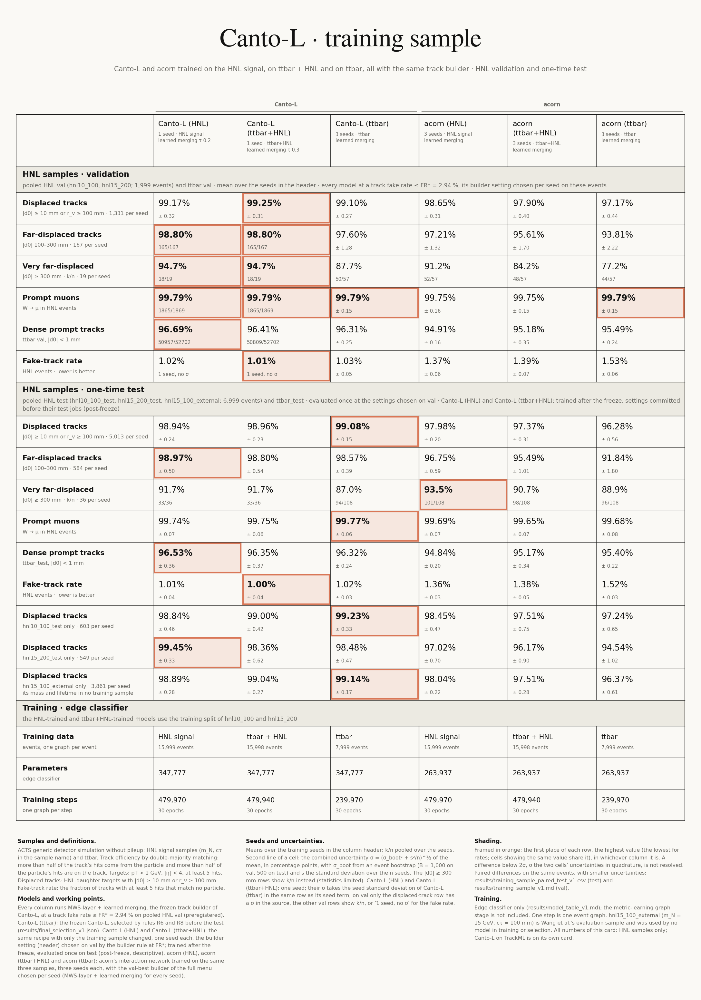

<p align="center">
  
</p>

<h1 align="center">Canto</h1>

<p align="center">
  <b>Graph-neural-network track reconstruction for displaced particles:<br>
  higher efficiency for a known signal, and strong generalization to particles it has not seen</b><br>
  <sub><b>C</b>hained-triplet, origin-<b>A</b>gnostic <b>N</b>etworks for <b>T</b>racking <b>O</b>ff-vertex</sub>
</p>

<p align="center">
  
  
  
  <a href="https://gitlab.cern.ch/gnn4itkteam/acorn/-/tree/99d153418981cba9018e70b476fc7ea0f17bacd4"></a>
  
</p>

<p align="center">
  <a href="#results">Results</a> ·
  <a href="#how-canto-works">How Canto works</a> ·
  <a href="#installation">Installation</a> ·
  <a href="#data">Data</a> ·
  <a href="#reproducing-the-results">Reproducing</a> ·
  <a href="#repository-layout">Layout</a>
</p>

---

Charged particles from the decay of a long-lived particle start far from the collision point, and trackers built
for prompt particles lose many of them. Canto has two aims:

- **Higher reconstruction efficiency for the displaced particles of a known signal.** Canto keeps the three stages of
  the Exa.TrkX pipeline (graph construction, edge classification, track building) and changes each one for particles
  produced off the vertex. Trained on the HNL signal, Canto-L (HNL) finds 98.94 ± 0.24 % of the displaced HNL
  daughters on the test sets, against 97.98 ± 0.20 % for acorn (HNL) trained on the same events and run with the same
  track builder (post-freeze, one Canto seed): it loses 1.06 % of them, acorn 2.02 %.
- **Strong generalization to displaced particles it has not seen.** A search for long-lived particles whose
  properties are not known in advance cannot train its tracker on the signal it looks for. Trained on generic
  top-quark pair (ttbar) events, Canto-L (ttbar) finds as many displaced HNL daughters as when it is trained on the
  signal; on the one-time test it finds 99.08 ± 0.15 % of them, 1.10 ± 0.22 points more than acorn (HNL) trained on
  the signal (post-freeze), and it finds K<sub>S</sub> and Λ daughters, which ttbar events do not contain, as well
  as the baselines that were trained on events containing them.

The benchmark is a public sample of heavy neutral leptons (HNLs), pp → W → μN, N → νμ⁺μ⁻, in the ACTS generic
detector without pileup. Canto is also tested on the TrackML challenge, with pileup 200 and noise hits.

## Results

The results come in three parts: (1) a known signal: Canto-L (HNL), trained on the HNL signal, on displaced and
far-displaced daughters; (2) generalization: Canto (ttbar), trained on generic ttbar events only, on the HNL signal
and on a second displaced population absent from its training events; (3) the TrackML challenge, with pileup 200.
The training sample of each model is in parentheses. MWS: Mutex Watershed that keeps the hits of one detector layer
apart. Efficiencies and rates in percent; bold: the best value of each row among the columns shown.

### 1. A known signal: Canto-L (HNL), trained on the HNL signal

When the signal is known, the tracker can be trained on it. Canto-L and acorn were each trained on the HNL signal
and on ttbar + HNL, and run with the same track builder, its setting chosen per seed on validation. Test events
(6,999 HNL events and the ttbar test set), evaluated once; one Canto-L seed per training sample, three acorn seeds;
uncertainties from the event bootstrap and the seed spread (for a one-seed Canto-L, the spread of the three Canto-L
(ttbar) seeds).

| | Canto-L (HNL) | acorn (HNL) | Canto-L (ttbar+HNL) | acorn (ttbar+HNL) |
|:---|:---:|:---:|:---:|:---:|
| *Track builder* | *MWS + learned merging* | *MWS + learned merging* | *MWS + learned merging* | *MWS + learned merging* |
| *Training seeds* | *1* | *3* | *1* | *3* |
| Displaced HNL daughters (\|d₀\| ≥ 10 mm or r<sub>v</sub> ≥ 100 mm) | 98.94 ± 0.24 | 97.98 ± 0.20 | **98.96 ± 0.23** | 97.37 ± 0.31 |
| \|d₀\| 100–300 mm | **98.97 ± 0.50** | 96.75 ± 0.59 | 98.80 ± 0.54 | 95.49 ± 1.01 |
| \|d₀\| ≥ 300 mm (found / total, seeds pooled) | 33 / 36 | **101 / 108** | 33 / 36 | 98 / 108 |
| Prompt muons (W → μ) | 99.74 ± 0.07 | 99.69 ± 0.07 | **99.75 ± 0.06** | 99.65 ± 0.07 |
| Prompt tracks in ttbar (\|d₀\| < 1 mm) | **96.53 ± 0.36** | 94.84 ± 0.20 | 96.35 ± 0.37 | 95.17 ± 0.34 |
| Fake-track rate (lower is better) | 1.01 ± 0.04 | 1.36 ± 0.03 | **1.00 ± 0.04** | 1.38 ± 0.05 |

- **Fewer displaced daughters lost.** acorn (HNL) loses 2.02 % of the displaced daughters, 1.9 times the 1.06 % of
  Canto-L (HNL); trained on ttbar + HNL, acorn loses 2.63 %, 2.5 times Canto-L's 1.04 %. Paired on the same events,
  Canto-L minus acorn is +0.96 ± 0.29 points trained on HNL (z = 3.4) and +1.60 ± 0.36 points trained on ttbar + HNL
  (z = 4.5), at a lower fake-track rate. On validation the two differences were +0.53 ± 0.37 and +1.35 ± 0.43 points.
- **The largest displacements.** The test sets hold 36 daughters with \|d₀\| ≥ 300 mm per seed: Canto-L (HNL) finds
  33, acorn (HNL) 101 of 108 over its three seeds and Canto-L (ttbar) 94 of 108; none of these differences is
  resolved. On validation, at a common edge working point, training on the signal raised Canto-L's edge efficiency
  for these daughters from 77.7 % (trained on ttbar) to 93.2 % (seed 0, 103 edges), and from 93.6 % to 96.1 % at
  100–300 mm.
- **Status.** Post-freeze and descriptive: these two Canto-L runs are not part of the frozen selection and decide no
  claim. Their settings were chosen on validation and committed before their test jobs
  ([selection](results/training_sample_test_selection_v1.json), [read-out](results/training_sample_spec_test_v1.json));
  results in [training_sample_test_v1.md](results/training_sample_test_v1.md) and
  [training_sample_paired_test_v1.csv](results/training_sample_paired_test_v1.csv), validation numbers in
  [training_sample_v1.md](results/training_sample_v1.md).

### 2. Generalization: Canto (ttbar), trained without the signal

A search for long-lived particles whose properties are not known in advance cannot train its tracker on the signal
it looks for. Canto (ttbar) never saw an HNL decay, a K<sub>S</sub> or a Λ.

**Signal training adds nothing measurable to Canto's displaced efficiency.** On the test sets, with the builder
above, Canto-L (ttbar) finds 99.08 ± 0.15 % of the displaced HNL daughters and Canto-L (HNL) 98.94 ± 0.24 %:
−0.13 ± 0.26 points from training on the signal. acorn gains +1.70 ± 0.54 points (96.28 ± 0.56 % to
97.98 ± 0.20 %); the difference between the two gains is +1.84 ± 0.60 points (z = 3.1). On validation the three
numbers were +0.08 ± 0.33, +1.48 ± 0.35 and +1.40 ± 0.47 points.

**On the HNL test sets, Canto (ttbar) finds more displaced daughters than acorn trained on the signal.** The models
were frozen on validation and evaluated once on the test sets (6,999 HNL events and the ttbar test set); this
evaluation decides the three [preregistered claims](docs/preregistration.md), which hold for Canto-L against
acorn (HNL) with its own builder, connected components (CC), at its preregistered cut. Every column has a track
builder (first row): Canto's was chosen on validation from its builder menu and frozen before the test; the first
two acorn columns run the best builder of the same menu, chosen on validation per seed (post-freeze, descriptive),
so that the comparison isolates the graph and the edge classifier. Uncertainties combine the event bootstrap and the
spread of three training seeds.

| | Canto-L (ttbar) | Canto-H (ttbar) | Canto-B (ttbar) | acorn (ttbar) | acorn (HNL) | acorn (HNL) |
|:---|:---:|:---:|:---:|:---:|:---:|:---:|
| *Track builder* | *MWS + learned merging* | *walk + helix merging* | *MWS + learned merging* | *MWS + learned merging* | *MWS + learned merging* | *connected components, preregistered cut* |
| Displaced HNL daughters (\|d₀\| ≥ 10 mm or r<sub>v</sub> ≥ 100 mm) | 99.08 ± 0.15 | **99.18 ± 0.13** | 98.43 ± 0.26 | 96.28 ± 0.56 | 97.98 ± 0.20 | 92.57 ± 0.47 |
| \|d₀\| 100–300 mm | **98.57 ± 0.39** | 98.40 ± 0.43 | 97.03 ± 0.88 | 91.84 ± 1.80 | 96.75 ± 0.59 | 91.72 ± 1.12 |
| \|d₀\| ≥ 300 mm (found / total, three seeds pooled) | 94 / 108 | 99 / 108 | 97 / 108 | 96 / 108 | **101 / 108** | 98 / 108 |
| Prompt muons (W → μ) | 99.77 ± 0.06 | 99.76 ± 0.06 | **99.78 ± 0.06** | 99.68 ± 0.08 | 99.69 ± 0.07 | 97.62 ± 0.32 |
| Prompt tracks in ttbar (\|d₀\| < 1 mm) | 96.32 ± 0.24 | 96.22 ± 0.16 | **96.58 ± 0.13** | 95.40 ± 0.22 | 94.84 ± 0.20 | 81.67 ± 0.33 |
| Fake-track rate (lower is better) | **1.02 ± 0.03** | 1.42 ± 0.04 | 1.29 ± 0.05 | 1.52 ± 0.03 | 1.36 ± 0.03 | 2.86 ± 0.05 |

- Canto-L (ttbar) finds **1.10 ± 0.22 points** more displaced daughters than acorn (HNL) with the same builder
  family chosen on validation (post-freeze), at a lower fake-track rate, and 6.50 ± 0.48 points more than acorn
  (HNL) with connected components at its preregistered cut.
- The exception is the far tail: above 300 mm acorn (HNL) finds 101 of 108 daughters (three seeds pooled) against
  94 for Canto-L (ttbar); with 36 daughters per seed, the difference is not resolved. In this range signal training
  raises Canto-L's edge efficiency on validation (section 1).
- On the evaluation sample of Wang et al. (Exa.TrkX large-radius tracking) and with their definitions, Canto-L
  (ttbar) finds 99.14 ± 0.05 % of all tracks against their published 95.61 ± 0.06 % (post-freeze).

**A second population of displaced particles**, used in no selection (test sets, post-freeze, nothing chosen on
them). K<sub>S</sub> and Λ daughters are absent from ttbar events, so the ttbar-trained models never saw one;
acorn (HNL) was trained on events that contain them. Photon conversions are in every model's training events.

| | Canto-L (ttbar) | Canto-H (ttbar) | Canto-B (ttbar) | acorn (ttbar) | acorn (HNL) | acorn (HNL) |
|:---|:---:|:---:|:---:|:---:|:---:|:---:|
| *Track builder* | *MWS + learned merging* | *walk + helix merging* | *MWS + learned merging* | *MWS + learned merging* | *MWS + learned merging* | *connected components, preregistered cut* |
| K<sub>S</sub> and Λ daughters in HNL events | 98.49 ± 0.44 | 98.60 ± 0.43 | **98.74 ± 0.40** | 98.27 ± 0.42 | 97.97 ± 0.45 | 88.35 ± 1.57 |
| e± from photon conversions in ttbar events | 78.27 ± 1.30 | 72.94 ± 1.51 | **78.61 ± 1.36** | 76.29 ± 1.44 | 74.25 ± 1.36 | 44.29 ± 2.62 |

### 3. TrackML challenge, throughput phase

Canto-L was retrained on 1,399 TrackML throughput-phase events (pileup 200, noise hits; one seed), with four cluster
features added to the inputs of its embedding and the HNL fake-rate working point kept, not re-tuned. It was
evaluated once on 300 test events; uncertainties from the event bootstrap. Details:
[TrackML model card](docs/model_card_canto_l_trackml.md).

| Test condition | Target efficiency | Fake-track rate | \|d₀\| ≥ 10 mm | \|d₀\| ≥ 100 mm (found / total) | TrackML score |
|:---|:---:|:---:|:---:|:---:|:---:|
| All hits (pileup 200, noise) | 99.65 ± 0.01 | 1.68 ± 0.01 | 88.2 ± 0.5 | 31 / 69 | 0.9660 ± 0.0001 |
| Noise hits removed | 99.66 ± 0.01 | 1.29 ± 0.01 | 88.5 ± 0.5 | 29 / 69 | 0.9676 ± 0.0001 |
| Hits of particles with p<sub>T</sub> > 1 GeV | 99.77 ± 0.01 | 0.055 ± 0.004 | 89.0 ± 0.5 | 33 / 69 | – |

**Comparison with published GNN trackers.** Only studies that, like our test, used throughput-phase events are
compared. Each comparison runs the reference's own evaluation code on our test events; published values as quoted
(Liu et al. quote no uncertainties). A Canto-L row marked *at FR ≤ x* uses a working point chosen on validation for
that reference's fake rate.

| Benchmark (evaluation code) | Model | Efficiency | Fake rate |
|:---|:---|:---:|:---:|
| TrackML-1GeV (EggNet code; Calafiura et al.) | EC | 98.98 ± 0.09 | 0.12 |
| | EggNet | 99.56 ± 0.03 | 0.06 |
| | Canto-L | 99.56 ± 0.01 | **0.008 ± 0.001** |
| | Canto-L *at FR ≤ 0.12* | **99.67 ± 0.01** | 0.039 ± 0.003 |
| TrackML-1GeV (HierarchicalGNN code; Liu et al.) | BC-HGNN | 98.55 | 1.23 |
| | Canto-L | **99.77 ± 0.01** | **0.26 ± 0.01** |
| Full TrackML (EggNet code; Chan et al.) | EggNet | 95.87 ± 0.03 | 0.19 ± 0.01 |
| | Canto-L | **99.41 ± 0.01** | 2.40 ± 0.01 |
| | Canto-L *at FR ≤ 0.19* | 99.37 ± 0.01 | **0.173 ± 0.003** |
| Full TrackML (HierarchicalGNN code; Liu et al.) | EC-GNN | 96.35 | 55.58 |
| | BC-HGNN | 97.86 | 36.71 |
| | Canto-L | **99.65 ± 0.01** | **34.94 ± 0.11** |

- In every benchmark Canto-L's efficiency is the highest or equal to the highest within the errors. At its own
  working point its fake rate with all hits and the EggNet code is 12.6 times EggNet's; at the working point chosen
  for EggNet's fake rate, it finds 99.37 % of the particles against 95.87 %, at a fake rate not resolved from
  EggNet's (1.7 σ).
- **Displaced particles in TrackML.** TrackML is a benchmark for prompt tracking: 1.2 % of the validation targets
  have \|d₀\| ≥ 10 mm. On validation (all hits), Canto-L finds 1,539 of the 1,562 such particles from the event generator
  (98.5 %; mostly K<sub>S</sub> and Λ daughters: 99.3 % and 97.2 %), and 206 of the 448 produced by the detector
  simulation in material interactions (46.0 %). 214 of the 265 losses occur at graph construction, for particles
  that cross the detector obliquely (large \|d₀\| / r<sub>first</sub>) at low p<sub>T</sub>
  ([diagnostic](results/trackml_displaced_diag_v1.txt)). The \|d₀\| ≥ 100 mm bin, 69 test targets, is reported,
  not claimed.

<details>
<summary><b>The training-sample card</b>: Canto-L and acorn, each trained on the HNL signal, on ttbar + HNL and on ttbar,
with the same track builder (validation and test)</summary>
<br>
<p align="center"></p>
<p align="center"><a href="figures/release/canto_card_training_sample.pdf">PDF</a> · <a href="figures/release/canto_card_training_sample.png">full-size PNG</a></p>
</details>

<details>
<summary><b>Every dataset and every model in one card</b> (validation, test, external sample, second displaced
population, TrackML, training)</summary>
<br>
<p align="center"></p>
<p align="center"><a href="figures/release/canto_card_full.pdf">PDF</a> · <a href="figures/release/canto_card_full.png">full-size PNG</a></p>
</details>

## How Canto works

| stage | acorn / Exa.TrkX | Canto |
|:---|:---|:---|
| **Graph** | metric-learning embedding, neighbors within a radius | the same graph, plus the legs of helix-consistent hit triplets (hand-cut support in Canto-H, learned support in Canto-L), which reach the hits of far-displaced tracks |
| **Edge classifier** | interaction network on hit positions | messages between hit triplets, inputs that do not depend on the production point, and training tracks whose innermost hits are removed at random, so that a track starting far out is not unusual |
| **Track builder** | connected components of the kept edges | a menu chosen on validation: Mutex Watershed that keeps the hits of one detector layer apart, followed by learned fragment merging (Canto-L, Canto-B), or a walk along high-score edges with helix merging (Canto-H) |

The three variants share the edge-classifier design and the builder menu and differ in the graph: **Canto-B** (the
base graph), **Canto-H** (hand-cut helix triplets) and **Canto-L** (learned triplet support, the selected variant).
Baselines: [acorn](https://gitlab.cern.ch/gnn4itkteam/acorn), the Exa.TrkX pipeline of the ATLAS GNN4ITk project,
retrained on ttbar, on the HNL signal and on both, and the interaction network of DeZoort et al.

## Installation

Built and run on the MIT subMIT cluster (NVIDIA A30, CUDA 12.6 toolchain):

```bash
export HNL_ROOT=/path/outside/home        # caches, environment, logs (env/env.sh refuses locations under $HOME)
export HNL_DATA=/path/to/data             # the samples and derived data
git clone https://github.com/powerofjinbo/Displaced_tracks_GNN.git $HNL_ROOT/hnl-displaced
cd $HNL_ROOT/hnl-displaced
bash env/make_env.sh --stage deps         # micromamba, Python 3.12, PyTorch 2.11 (cu126), PyG 2.7, Lightning 2.6
bash env/make_env.sh --stage build,smoke  # on a GPU node: FRNN, acorn 99d15341 + patches/acorn, this package
source env/activate.sh
```

`HNL_ROOT` and `HNL_DATA` must be set in every shell before `env/activate.sh`; otherwise `env/env.sh` falls back to
the subMIT locations. `env/lock.txt` records the versions used for the results. The job scripts in `slurm/` carry
the site's paths and partition names.

## Data

| sample | source | used for |
|:---|:---|:---|
| HNL and ttbar events in the ACTS generic detector | X. Ju, *Large Radius Tracking Events in pp collisions with a Generic detector*, [doi:10.5281/zenodo.6812533](https://doi.org/10.5281/zenodo.6812533) | training (ttbar), validation, test; splits in `splits/` |
| TrackML throughput phase | [doi:10.5281/zenodo.4730157](https://doi.org/10.5281/zenodo.4730157) | retraining and test on TrackML; split in `configs/trackml/split_tp_v1.json` |

## Reproducing the results

| step | entry point |
|:---|:---|
| data | download the samples to `$HNL_DATA/raw`, then `slurm/unpack.sbatch` and `slurm/convert.sbatch` |
| acorn baselines (metric learning, GNN, evaluation) | `slurm/baseline/orchestrate.sh slurm/baseline/plan_v1.txt` |
| Canto variants (graphs, edge classifier, builders) | `slurm/stage1/orchestrate_s1.sh slurm/stage1/plan_final_{base,union,learned}.txt` |
| selection on validation, then the one-time test | `python -m hnl.eval.final_select`, `slurm/stage1/final_test_chain.sh` |
| TrackML pipeline and test | `slurm/trackml/` (`_common.sh` documents the run layout) |
| release cards (read the stored evaluation outputs, which are not in the repository) | `python -m hnl.plots.release_card_full --out figures/release/canto_card_full`, `python -m hnl.plots.release_card_training_sample --out figures/release/canto_card_training_sample` |
| tests | `pytest` (tests marked `data` or `gpu` need the samples or a CUDA device) |

## Repository layout

```text
src/hnl/          the package: data, truth, geometry, graphs, models, train, trackbuild, vertex, eval, plots, trackml
configs/          model and pipeline configurations
slurm/            job scripts and orchestrators
scripts/          diagnostics and maintenance scripts
tests/            unit tests
splits/           event lists of every split
results/          result tables
figures/          figures and release cards
docs/             definitions, preregistration, TrackML model card
env/, patches/    environment build; the patches applied to acorn
NOTICE, LICENSES/ third-party material and its licences
branding/         the mascot and the banner (sources in branding/mascot/)
```

## Provenance and credits

The project was developed in a private repository whose history is the full record; commit hashes cited in
comments and documents refer to that history. Model checkpoints are not included. A paper is in preparation; a
licence for the code will be added with it. Third-party material is listed in [`NOTICE`](NOTICE). The gecko in the
banner is Tercet, whose tail carries three hits; it is drawn in code in [`branding/`](branding/).
